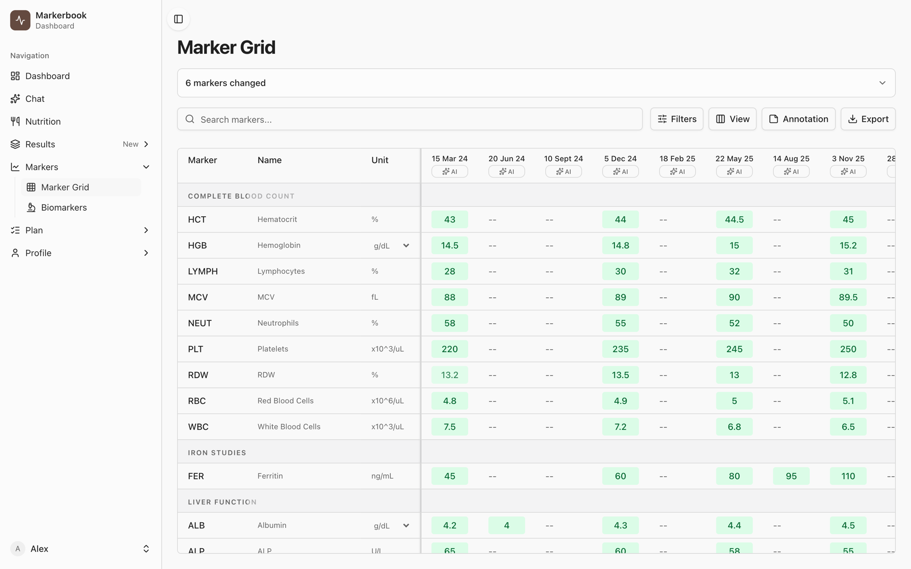
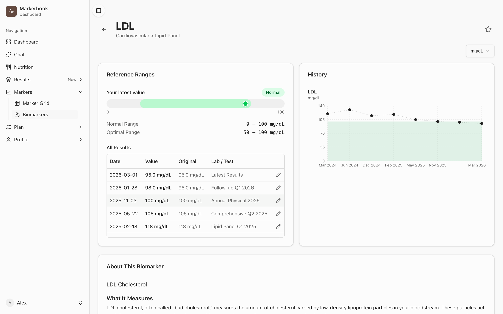
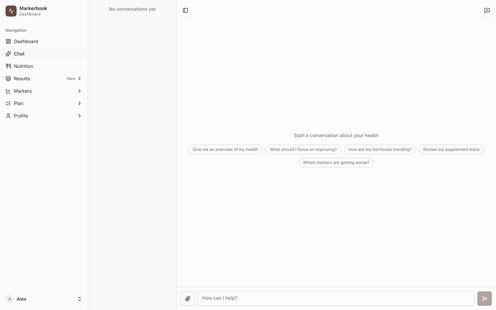
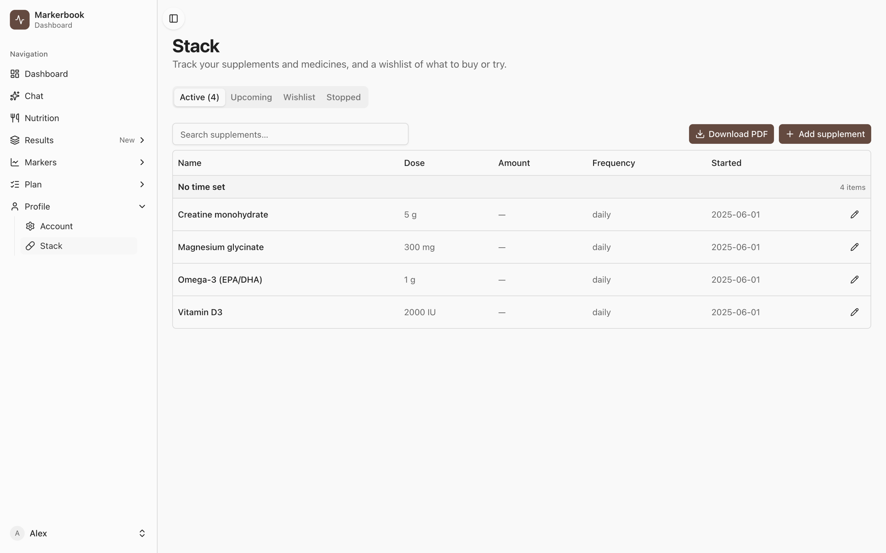
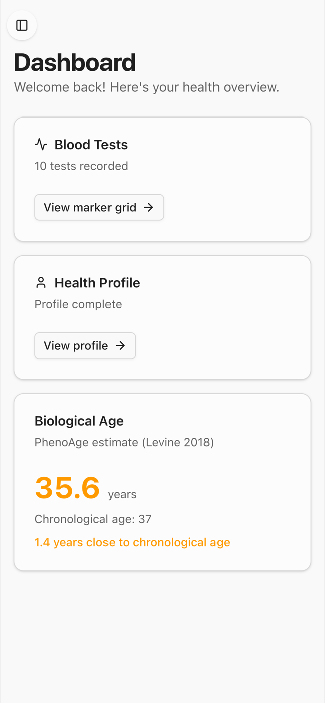
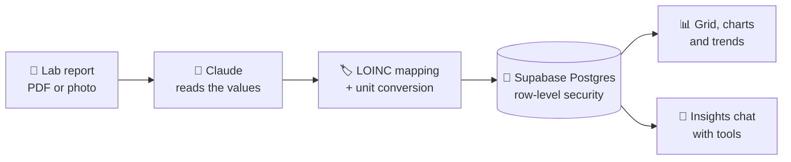

<div align="center">


# Markerbook

**All your lab results in one place. Self-hosted, AI-powered, yours.**

Upload a lab report as PDF or photo. Markerbook reads the values, puts every test
on one timeline, and lets you ask an AI assistant about your own data.

[](https://github.com/nevilhulspas/markerbook/actions/workflows/ci.yml)
[](LICENSE)
[](docs/SELF_HOSTING.md)
[](CONTRIBUTING.md)


[Features](#features) · [Screenshots](#screenshots) · [Quick start](#quick-start) · [Self-hosting](docs/SELF_HOSTING.md) · [Contributing](CONTRIBUTING.md)

<br>

<picture>
  <source media="(prefers-color-scheme: dark)" srcset="docs/assets/screenshots/grid-dark.png">
  
</picture>

<sub>The marker grid with demo data: every marker, every test, one view.</sub>

</div>

> [!IMPORTANT]
> **Not a medical device. Not medical advice.** Markerbook organises data you already
> have. Its AI output can be wrong. Talk to a doctor about your health. The software
> comes without any warranty.

## Why Markerbook?

Lab results arrive as PDFs from different labs, in different units, years apart.
Comparing them by hand is slow, and the trend is what matters.

- **One timeline for everything.** Blood work, hormones, gut microbiome, body scans and
  genetics, side by side.
- **No typing.** Drop in a PDF or a phone photo; the AI reads the values and maps each
  one to a standard [LOINC](https://loinc.org) code, so "Ferritine" and "Ferritin" end up
  on the same line.
- **Ask your data.** "Which markers got worse since last year?" The assistant answers from
  your own results, with sources.
- **Your server, your data.** Everything is stored in your own Supabase project. Only
  the AI requests leave it, to Anthropic, with your own API key.

## Features

<table>
<tr>
<td width="50%" valign="top">

### 🩸 Blood tests
PDF and photo import with AI extraction, manual entry, a marker × date grid,
reference ranges, unit conversion, and PDF / CSV export.

</td>
<td width="50%" valign="top">

### 🧪 More than blood
DUTCH hormone tests, gut microbiome, DEXA body scans, resting metabolic rate,
genetics (SNP files) and any other report.

</td>
</tr>
<tr>
<td valign="top">

### 💬 Insights chat
An AI assistant with tools over all of your data: it reads trends, compares tests,
remembers your goals, searches the web and takes document uploads in the chat.

</td>
<td valign="top">

### 📈 Trends and context
A history chart and reference ranges for every marker, a biological-age estimate
(PhenoAge), annotations, and a summary of what changed since your last test.

</td>
</tr>
<tr>
<td valign="top">

### 🥗 Nutrition
Log food by text, voice or photo. Uses the Dutch NEVO food database and Open Food
Facts, with recipes and your own foods.

</td>
<td valign="top">

### 💊 Supplements
Your stack with doses and intake times, start and stop dates, a wishlist, and a
PDF to share.

</td>
</tr>
<tr>
<td valign="top">

### 🗓️ Plan your next test
A "next to test" list and a lab catalogue, so you know which tests to order where.

</td>
<td valign="top">

### 📱 Phone ready
A responsive web app, plus an optional iOS shell (Capacitor) that loads your own
server.

</td>
</tr>
</table>

## Screenshots

<table>
<tr>
<td width="50%">
<picture>
  <source media="(prefers-color-scheme: dark)" srcset="docs/assets/screenshots/biomarker-dark.png">
  
</picture>
<p align="center"><sub><b>Every marker</b>: ranges, all results and the trend</sub></p>
</td>
<td width="50%">
<picture>
  <source media="(prefers-color-scheme: dark)" srcset="docs/assets/screenshots/insights-dark.png">
  
</picture>
<p align="center"><sub><b>Insights chat</b>: ask questions about your own data</sub></p>
</td>
</tr>
<tr>
<td width="50%">
<picture>
  <source media="(prefers-color-scheme: dark)" srcset="docs/assets/screenshots/supplements-dark.png">
  
</picture>
<p align="center"><sub><b>Supplement stack</b>: doses, schedule and history</sub></p>
</td>
<td width="50%" align="center">

<p align="center"><sub><b>On your phone</b>: the same app, any screen</sub></p>
</td>
</tr>
</table>

<sub>All screenshots use made-up demo data.</sub>

## How it works



Each user only ever sees their own rows: access is enforced in the database with
row-level security, not only in the app. Every AI request counts toward a per-user
limit that you set, because the AI costs go to your own API key.

## Quick start

You need **Node 22+**, **[Docker](https://www.docker.com/products/docker-desktop/)**, the
**[Supabase CLI](https://supabase.com/docs/guides/cli)** and an
**[Anthropic API key](https://console.anthropic.com)**.

### With Claude Code (easiest)

```bash
git clone https://github.com/nevilhulspas/markerbook.git markerbook
cd markerbook
claude
```

Then type **`/setup`**. Claude checks your tools, asks for your e-mail address and API
key, starts the local database and the app, and tells you where to sign up.

### By hand

```bash
git clone https://github.com/nevilhulspas/markerbook.git markerbook
cd markerbook
npm run setup      # checks your tools, starts the database, writes .env.local
npm run dev        # http://localhost:3000
```

Sign up with the e-mail address you gave the setup: that account becomes admin
automatically. Want to look around first? `npm run demo` loads made-up results into
your account.

### Run it for real

Deploy to your own server with a Supabase cloud project or self-hosted Supabase.
There is a [Dockerfile](Dockerfile), and the
**[self-hosting guide](docs/SELF_HOSTING.md)** walks through the database, sign-in,
optional data sets, updates and a privacy checklist.

```bash
supabase link --project-ref <your-project-ref>
supabase db push --include-seed
docker build --build-arg NEXT_PUBLIC_SUPABASE_URL=... \
  --build-arg NEXT_PUBLIC_SUPABASE_PUBLISHABLE_KEY=... \
  --build-arg NEXT_PUBLIC_SITE_URL=https://health.example.com -t markerbook .
docker run -p 3000:3000 --env-file .env.local markerbook
```

## Tech stack

| Layer | Tools |
|---|---|
| App | Next.js 16 (App Router, Turbopack), React 19, TypeScript (strict) |
| UI | Tailwind CSS 4, shadcn/ui, Recharts, TanStack Table |
| Data | Supabase: Postgres with row-level security, Auth, Storage |
| AI | Anthropic Claude via the Vercel AI SDK and `@anthropic-ai/sdk`; OpenAI Whisper for voice (optional) |
| Mobile | Capacitor 8 iOS shell (optional) |
| Quality | Vitest (1,400+ tests), ESLint, CI on every pull request |

## Development

| Command | What it does |
|---|---|
| `npm run setup` | First-time local setup: database, catalogue, `.env.local` |
| `npm run demo` | Made-up demo results for your account |
| `npm run dev` | Dev server |
| `npm run build` / `npm start` | Production build / serve |
| `npm run lint` | ESLint |
| `npm run typecheck` | `tsc --noEmit` |
| `npm test` | Vitest |
| `npm run gen:types` | Regenerate database types from the linked Supabase project |

Adding a new kind of health test (for example a SIBO breath test) is one registry
entry; the chat upload and indexing pick it up on their own. See
[CLAUDE.md](CLAUDE.md) for the project conventions.

## Contributing

Bug reports, fixes and ideas are welcome. Read [CONTRIBUTING.md](CONTRIBUTING.md)
first, and please never put real health data in an issue, test or screenshot.

Found a security problem? Report it privately, see [SECURITY.md](SECURITY.md).

## Acknowledgements

- [LOINC](https://loinc.org) by Regenstrief Institute for lab test codes
- [NEVO](https://www.rivm.nl/en/dutch-food-composition-database) by RIVM and
  [Open Food Facts](https://world.openfoodfacts.org) for food data
- [shadcn/ui](https://ui.shadcn.com) and [Lucide](https://lucide.dev) for the interface
- [Anthropic Claude](https://www.anthropic.com) for reading lab reports

Third-party data and their terms are listed in [NOTICE](NOTICE).

## License

[GNU Affero General Public License v3.0 or later](LICENSE). You may use, change and
share Markerbook. If you run a changed version for other people, you must offer
them its source code too.
